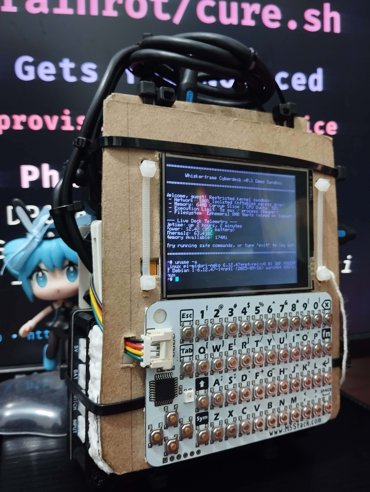
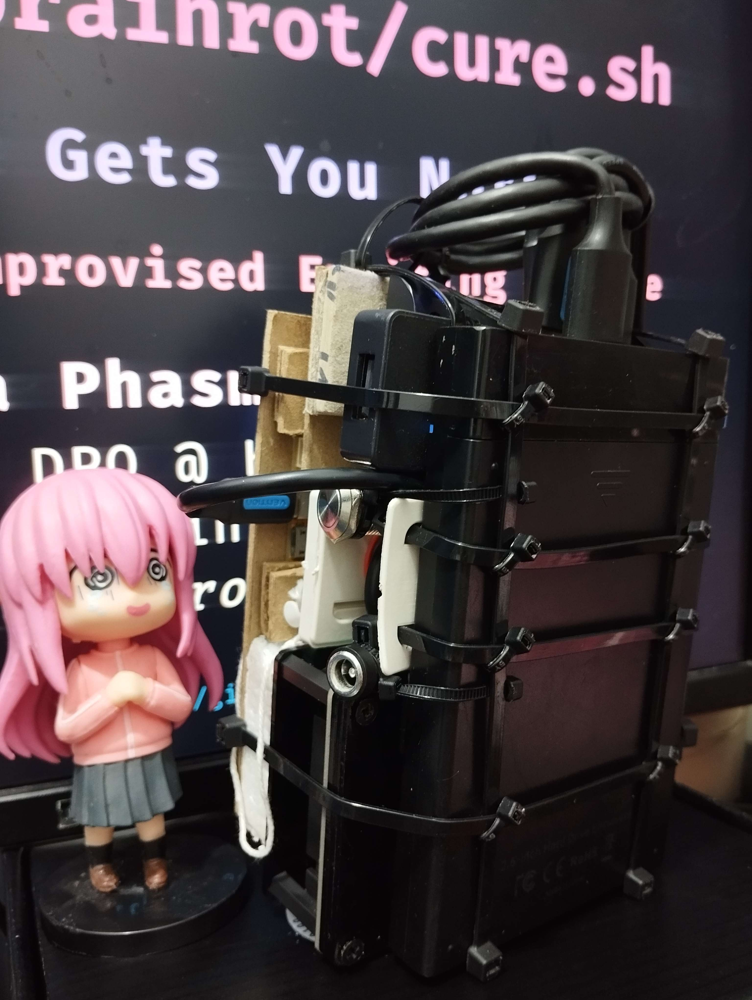

<!-- _footer: "https://lyra-on.top • https://github.com/whinee" -->

# /home/lyra/.brainrot/cure.sh

## Weird Hardware Gets You Noticed
### WhiskerFrame, the Improvised Exciting Device

<b>Lyra Phasma</b>
Software Dev, DPO @ Klik-A-Snap
Sysadmin, Cyberdeck Gremlin @ Heart
*@ Hack & Yap Ep. II — Zero-Ten Park, Makati*

---

## 🕒 2:00 AM: Doomscroll Loop

- Pillow feels like quicksand
- Brain cells melting into vertical video sludge
- Willpower is at `0%`
- Discipline died in 2024

---

## 💡 The Hypothesis

You cannot out-willpower an infinite algorithm.

The cure isn't discipline.

**It's having something weird on your desk you'd rather poke at.**

---

## 📦 Meet WhiskerFrame

- Tiny computer board, screen, clicky keys
  *(Pi Zero 2W, ESP32 CYD, CardKB)*
- Runs Linux, smells of solder and caffeine

---

## 💣 Why "IED"?

**I**mprovised **E**xciting **D**evice

- Zip ties, chipboard, exposed nest of wires
- Movie C4 prop
- Security feature: appearance alone deters people from touching it
- P.D. No. 1727 of PH

---

## 🎪 AWS Build Over Nights

- Pitch didn't win. Ready to head home defeated.
- Mentor pushed me to pull out cyberdeck in lobby.
- **"CUT THE RED WIRE!"**
- Commotion grew to 30 people gathering round.

---

## 🎟️ AWS Builder Day 2026

- Lobby hype led straight to an invite.
- **AWS User Group PH** booth manpower.
- Demoed cyberdeck live on venue floor.
- Built with AWS Kiro in under 2 days.

---

## ⚡ Why Weird Hardware Works

- Code on GitHub is invisible to passersby.
- **Physical hardware is walk-up-able.**
- Tactile curiosities start conversations software pitches can't.

---

## 🤖 AI vs. Human Reality

<table class="ledger">
  <thead>
    <tr>
      <th style="width: 48%;">What AI Did ✨</th>
      <th style="width: 52%;">What Lyra Suffered 😭</th>
    </tr>
  </thead>
  <tbody>
    <tr>
      <td>FastAPI boilerplate & Python models</td>
      <td>Which wires talk? <i>(I2C-0 vs I2C-1 pin routing)</i></td>
    </tr>
    <tr>
      <td>Inverted screen boot colors backwards</td>
      <td>Stiff neck staring up; rigged OBS camera to view screen</td>
    </tr>
    <tr>
      <td>Ansible playbooks for setup</td>
      <td>512MB RAM Pi died on Docker; wrote native systemd script</td>
    </tr>
  </tbody>
</table>

---

## 🧪 Did It Cure Brainrot?

- **Replaced phone yet?** Not yet.
- **Result so far:** Tinker way more at my desk.
- **Verdict:** Hard to doomscroll at 2 AM when your hands are full of wires.

---

## 🔓 Everything. Open. Source.

- Firmware, software, scripts
- BOM, hardware, 3D case models
- Docs, online *AND* offline
- **Free forever.** *(Free as in freedom, not as in I eat.)*

---

## 🐾 The Ask

- **v1 kit:** a proper case. It will *NOT* look like a bomb.
- Parts, tools, and time to make v1 real
- $1 / ~₱60 = you pick the boot-splash message :3

**Help me keep this free for everyone, forever.**

---

## 🎯 Takeaways

1. **Tactile friction beats willpower.**
   *Put something physical on your desk.*
2. **Physical builds get noticed.**
   *Make projects people can walk up to.*
3. **Rebel against the feed.**
   *REVEL IN FOSS! :3*

---

# Thank you besties! ✨

### Now go touch grass (or wire an I2C sensor).

*Questions? Complaints?*
*Send them to `/dev/null`* :3

*GitHub: @whinee • Web: lyra-on.top*
